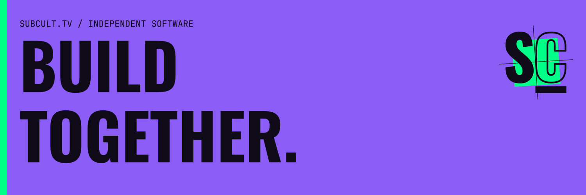

# SUBCULT

**Software for independent culture.**

We make tools for the people who keep culture running without a budget: someone clipping a stream, a zine archive, a neighborhood board, the door at a Friday show. Some of it is live, a lot of it is early, and every repository below is public, so you can read the code before you use it.

[Website](https://subcult.tv) · [Products](https://subcult.tv/products) · [Contact](mailto:info@subcult.tv)

## Streams and clips

- **[clpr](https://github.com/subculture-collective/clpr)**: find Twitch clips by creator, topic and tag, and keep playlists to share. [clpr.tv](https://clpr.tv)
- **[Headcount](https://github.com/subculture-collective/headcount)**: a public dashboard that scores the Twitch top 200 for bot-like viewer and chat patterns. A signal, not proof. [headcount.subcult.tv](https://headcount.subcult.tv/)
- **[Chatty Cat](https://github.com/subculture-collective/chatty-cat)**: a self-hosted Twitch chat client with merged and split channel panes. [chat.subcult.tv](https://chat.subcult.tv)
- **[Overlaid](https://github.com/subculture-collective/overlaid)**: self-hosted OBS overlays, a Twitch chat bot and a stream desk for one operator.
- **[vod-tender](https://github.com/subculture-collective/vod-tender)**: archives a Twitch channel's VODs and chat, with optional YouTube upload.
- **[twitchdl](https://github.com/subculture-collective/twitchdl)**: a command-line tool that downloads Twitch clips and VODs and records live streams.
- **[ytclip](https://github.com/subculture-collective/ytclip)**: one Bash command for a whole YouTube video or a timestamped clip.
- **[JuryRigged](https://github.com/subculture-collective/jury-rigged)**: a courtroom drama played by language models, with audience votes and Twitch chat.

## Archives

- **[HasanAra](https://github.com/subculture-collective/hasanara)**: search HasanAbi broadcasts by phrase and land on the timestamp. Transcripts are automatic, so check the recording before you quote it. [hasanara.tv](https://hasanara.tv)
- **[Rekolekt](https://github.com/subculture-collective/rekolekt)**: software you deploy for timestamped, searchable recording archives. HasanAra runs on it. [rekolekt-web](https://github.com/subculture-collective/rekolekt-web) is its headless React kit.
- **[assmold](https://github.com/subculture-collective/assmold)**: an Asmongold broadcast archive built from HasanAra. Its public site is retired.
- **[Chicago Labor Archive](https://github.com/subculture-collective/chicago-labor-archive)**: a reading room for Chicago-area labor and radical press, with text search. [cla.subcult.tv](https://cla.subcult.tv/)
- **[Riot Grrrl Zine Archive](https://github.com/subculture-collective/arkhiv-riot-grrrl)**: a catalog and on-site reader for preserved Riot Grrrl zines, with source and rights notes. [riot-grrrl.subcult.tv](https://riot-grrrl.subcult.tv/)
- **[Anarchist Archive](https://github.com/subculture-collective/arkhiv-anarchist)**: preserved anarchist zines and pamphlets with a catalog, reader and downloads. [anarchist-archive.subcult.tv](https://anarchist-archive.subcult.tv)
- **[Lineage](https://github.com/subculture-collective/lineage)**: browse and play Live Music Archive recordings with their taper credits and lineage. [lineage.subcult.tv](https://lineage.subcult.tv/)
- **[Dedhed](https://github.com/subculture-collective/dedhed)**: Grateful Dead audience tapes, on demand or on a shared station. A small public pilot. [dedhed.subcult.tv](https://dedhed.subcult.tv)
- **[Democracy Now! broadcast archive](https://github.com/subculture-collective/democracy-now-tv)**: an independent archive with on-demand viewing and a scheduled replay channel. Not affiliated with the show. [democracy-now.subcult.tv](https://democracy-now.subcult.tv/)
- **[Bill Nye TV](https://github.com/subculture-collective/bill-nye-tv)**: an independent episode archive with a shared replay channel and a CRT-styled player. Not affiliated with the show. [bill-nye.subcult.tv](https://bill-nye.subcult.tv/)
- **[Byl](https://github.com/subculture-collective/byl)**: local history walking and cycling tours with sourced stories, for web, iOS and Android. [byl.subcult.tv](https://byl.subcult.tv)

## Making and publishing

- **[Undertow](https://github.com/subculture-collective/undertow)**: a layered music visualizer with timed lyrics that exports MP4 in your browser. Export support depends on the browser and device. [undertow.subcult.tv](https://undertow.subcult.tv)
- **[Kork](https://github.com/subculture-collective/kork)**: free link pages for your socials, payment buttons and contact details. Tips go to your own accounts. [kork.subcult.tv](https://kork.subcult.tv/)
- **[aski](https://github.com/subculture-collective/aski)**: a browser text-art studio with font families, palettes, and image and GIF export.
- **[Deadweb Relay](https://github.com/subculture-collective/deadweb-relay)**: an old-web homepage with writable notes, feeds and plain-HTTP discovery. [www2-observatory](https://github.com/subculture-collective/www2-observatory) reads its logs to show how visitors and crawlers use it. [www2.onnwee.me](https://www2.onnwee.me/)

## Organizing

- **[Patchwork](https://github.com/subculture-collective/patchwork)**: a pre-alpha AT Protocol demo where neighbors ask for and offer local help. It is a demo; please don't use it for a real request. [patchwork.subcult.tv](https://patchwork.subcult.tv)
- **[Subcult OS](https://github.com/subculture-collective/subcult-os)**: event planning, staffing, free ticket reservations and door check-in for small shows. In development. [os.subcult.tv](https://os.subcult.tv/)
- **[Roberts Rules](https://github.com/subculture-collective/roberts-rules)**: a simulator and live floor for chair-led parliamentary meetings. Early stage.
- **[dsa-signal](https://github.com/subculture-collective/dsa-signal)**: members-only encrypted chat on a private Matrix server. In development.
- **[Left Field](https://github.com/subculture-collective/left-field)**: seat-level election research with sourced records and provisional, versioned scores. Not a forecast. [left-field.subcult.tv](https://left-field.subcult.tv/)
- **[Commons](https://github.com/subculture-collective/commons)**: a hub for finding and building open alternatives to familiar software. [commons.subcult.tv](https://commons.subcult.tv/)
- **[Backline](https://github.com/subculture-collective/backline)**: a Discord bot and dashboard for onboarding, moderation, tickets and feeds. Private pilot. [backline.subcult.tv](https://backline.subcult.tv/)

## Social web

- **[Prichal](https://github.com/subculture-collective/prichal)**: hosting for your own Bluesky account server. Your server. We keep it running. Private preview. [prichal.subcult.tv](https://prichal.subcult.tv)
- **[Pirs](https://github.com/subculture-collective/pirs)**: experimental plugin hook points and a sandboxed plugin host for an AT Protocol PDS, with its [AT Protocol fork](https://github.com/subculture-collective/pirs-atproto).

## Research and games

- **[Clustr](https://github.com/subculture-collective/clustr)**: maps Reddit communities by the users they share, as a 3D network you can explore. [clustr.subcult.tv](https://clustr.subcult.tv) [Clustr Galaxy](https://github.com/subculture-collective/clustr-galaxy) is a controller-first Unity client for the same data.
- **[The Common House](https://github.com/subculture-collective/the-common-house)**: a first-person narrative investigation game set at a radio outpost. Early prototype.
- **[Edda](https://github.com/subculture-collective/edda)**: a tabletop roleplaying game with a language-model game master, in the browser or the terminal. [edda.subcult.tv](https://edda.subcult.tv/)
- **[Artemis Mission Hub](https://github.com/subculture-collective/artemis)**: NASA Artemis schedules, updates, media and live trajectory on one dashboard. [artemis.subcult.tv](https://artemis.subcult.tv/)
- **[Mantik](https://github.com/subculture-collective/mantik)**: a terminal-first paper-trading research system. Synthetic demo data; no live trading.

## Developer tools

- **[Switchyard](https://github.com/subculture-collective/switchyard)**: a self-hosted runtime for model routing, scheduled workflows and coding-agent runs.
- **[Subsets](https://github.com/subculture-collective/subsets)**: find, group and switch agent skills, with previews and rollback. [subsets.subcult.tv](https://subsets.subcult.tv)
- **[Generic Skills](https://github.com/subculture-collective/generic-skills)**: portable skills for coding agents: development, review, debugging, research and writing. [patstack](https://github.com/subculture-collective/patstack) is the larger personal library they come from.
- **[super-productivity-mcp](https://github.com/subculture-collective/super-productivity-mcp)**: an MCP server, plugin and quick-add that connect AI clients to Super Productivity.
- **[Tadooer](https://github.com/subculture-collective/tadooer)**: a self-hosted task and calendar planner for one person, with CalDAV and Google Calendar.

## Desktop, terminal and hardware

- **[Subarchy](https://github.com/subculture-collective/subarchy)**: an Arch Linux desktop distribution with its own Hyprland shell. In development.
- **[Pult](https://github.com/subculture-collective/pult)**: themes your other terminal apps from one palette, with undo. [pult.subcult.tv](https://pult.subcult.tv)
- **[fl-live](https://github.com/subculture-collective/fl-live)**: a Linux music workstation built on Qt, QML and PipeWire. In development.
- **[tmux-popups](https://github.com/subculture-collective/tmux-popups)**: opens your terminal tools in tmux popups from one registry. [tmux-popups.subcult.tv](https://tmux-popups.subcult.tv)
- **Omarchy plugins**: [Multi-Monitor Bar](https://github.com/subculture-collective/omarchy-monitor-bar) (a bar layout per monitor), [Shelfish](https://github.com/subculture-collective/omarchy-plugin-shelfish) (bar widgets grouped into shelves), [Spool](https://github.com/subculture-collective/omarchy-plugin-spool) (a cassette that follows your coding sessions), [Super Productivity](https://github.com/subculture-collective/omarchy-superproductivity) (your current task in the top bar) and [TOZO HT3](https://github.com/subculture-collective/omarchy-plugin-ht3) (headphone volume, ANC and EQ).
- **[Metronome + Tuner](https://github.com/subculture-collective/obsidian-plugin-metronome-tuner)**: a metronome and chromatic tuner inside Obsidian, on desktop and mobile.
- **[TOZO Control](https://github.com/subculture-collective/tozo-control)**: a Linux GTK app for TOZO earbuds and headphones, forked from GabriWar's project.
- **[Room Scanner](https://github.com/subculture-collective/room-scanner)**: scan a room with iPhone or iPad LiDAR and get a measured floor plan.
- **[TD-H3 Plus Tools](https://github.com/subculture-collective/td-h3-plus-tools)**: scripts and channel plans for programming a TIDRADIO TD-H3 Plus radio.

## Get involved

Every repository takes bug reports and feature requests in GitHub Issues and code as pull requests against `main`. The bigger products also have Discussions for questions. Start with the project's README; it says how to run it and what CI checks.

For collaborations or anything else, email [info@subcult.tv](mailto:info@subcult.tv).
